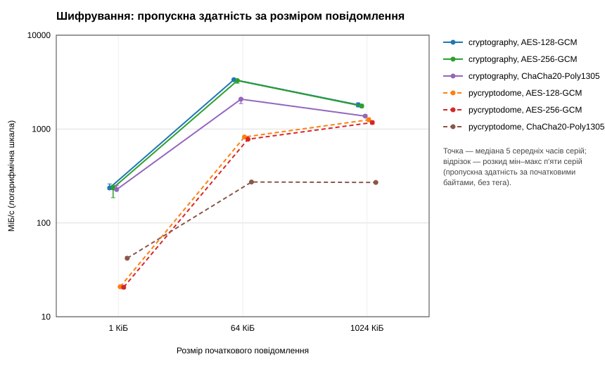
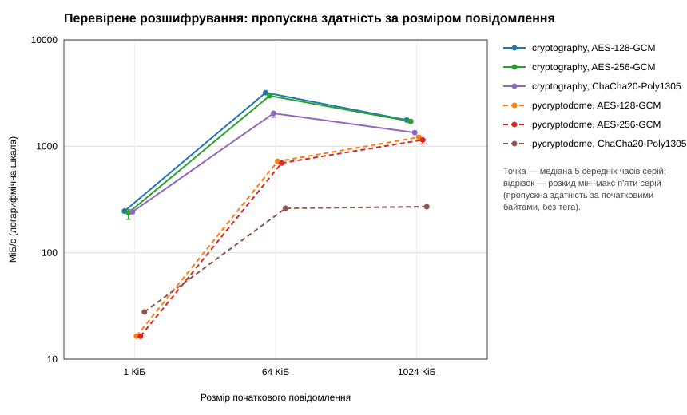

# Звіт практичної роботи 2: симетричне шифрування приміток

Студент: Саверський Денис, група 233 (online), номер у списку 17. Індивідуальний варіант: 17 mod 4 = **1** («Категорія примітки»).

## Відомості про виконання

- Власний форк `digital-dean-api-starter`, гілка `practice-02`, теги `practice-01`, `practice-02-base` та `practice-02`.
- Гілка створена від `practice-01`, до неї злито `upstream/practice-02-starter`; тег `practice-02-base` позначає стан одразу після злиття.
- Власні коміти після `practice-02-base`:

  - `Add symmetric encryption adapters and crypto dependencies`
  - `Integrate protected notes and benchmark report into the API`
  - `Add crypto and secure note tests`
  - `Add benchmark module, chart generator and its tests`
  - (цей коміт) Add benchmark results, Postman scenarios, README and report

## Зміни в наявному API

- `app/security/profiles.py` — перевірка профілів (ключ 16/32 байти, nonce 12 байтів, тег 16).
- `app/security/adapters.py` — `seal_bytes` / `open_bytes` для шести комбінацій; `cryptography` повертає тег разом із шифротекстом, `PyCryptodome` окремо, адаптер зводить обидва до пари `(ciphertext, tag)`. Розшифрування лише після перевірки тега, помилка → `CiphertextError`.
- `app/security/context.py` — канонічний JSON-контекст (AAD): `version`, `student_id`, `note_id`, `algorithm`, `key_id` і `category` (варіант 1).
- `app/security/nonce.py` — лічильник одноразових значень під `Lock`, межа 1 000 000, після неї `RuntimeError`.
- `app/security/keys.py` — один ключ AES-256 (`secrets.token_bytes(32)`), `key_id` і один лічильник на процес; ключ лише в пам'яті.
- `app/schemas/secure_note.py` — `NoteCreate` (1–4096 байтів UTF-8, не лише пробіли, `extra="forbid"`, `strict`), `category`, `NoteMetadata`, `NoteRead`.
- `app/repositories/secure_note_repository.py` — зберігає лише конверт (`version`, `student_id`, `note_id`, `algorithm`, `backend`, `key_id`, `nonce`, `ciphertext`, `tag`, `category`); поля `text` і ключа немає.
- `app/api/secure_notes.py` — `POST /api/v1/students/{student_id}/secure-notes` (201/404/422/503) і `GET .../{note_id}` (200/404/422/500). Базовий профіль: AES-256-GCM, `cryptography`.
- `app/api/crypto_lab.py` — `GET /api/v1/lab/crypto/benchmark-results` читає й перевіряє `results/practice-02/report.json` (404 / 500).
- `app/main.py`, `pyproject.toml` — версія `0.2.0`, підключені маршрутизатори, залежності `cryptography==48.0.1`, `pycryptodome==3.24.0`.
- `benchmarks/crypto_benchmark.py`, `benchmarks/make_charts.py` — дослід і побудова графіків.

Маршрути та моделі роботи 1 не змінювалися; їхні тести проходять.

### Індивідуальний варіант 1

Поле `category` ∈ {`general`, `academic`, `administrative`} (за замовчуванням `general`) додано до запиту, відповіді, конверта й AAD. Невідома категорія дає 422. Якщо змінити збережену категорію, тег не збігається і `GET` повертає 500 `{"detail": "Protected note unavailable"}` без тексту.

## Фактичне середовище та методика

| Параметр | Значення |
|---|---|
| Процесор | AMD Ryzen 5 5500 (12 логічних ядер) |
| ОС / архітектура | Windows-10-10.0.19045-SP0 / AMD64 |
| Python | 3.13.16 (CPython) |
| cryptography | 48.0.1, OpenSSL: OpenSSL 4.0.1 9 Jun 2026 |
| pycryptodome | 3.24.0 |
| Апаратне прискорення | скрипт не зміг визначити; висновків про нього не робимо |
| Таймер | `time.perf_counter_ns`, роздільність 1e-07 с |
| Код під час досліду | комміт `47b55798917931086a2a64c168190b3785275702` |
| Початок запуску (UTC) | 2026-10-31T15:01:32+00:00 |
| Ідентифікатор запуску | `20261031T150132Z-47dc8e` |

Методика: розміри 1024, 65536 і 1048576 байтів; для одного розміру всі реалізації одержують однакові випадкові байти й однаковий 64-байтовий контекст. Для кожної комбінації окремий випадковий ключ і власний лічильник nonce; ключі не пов'язані з ключем API. Перед виміром перевірено точне відновлення даних. Для кожного розміру й операції — прогрівання 10 операцій, потім 5 серій по 100 операцій; nonce для шифрування нові також у прогріванні й під час підготовки конвертів для розшифрування. Усередині таймера: створення об'єкта бібліотеки та операція (шифрування або розшифрування з перевіркою тега) з обгорткою адаптера. Ключі, дані, контекст і конверти готуються поза таймером. Порядок комбінацій змінюється між серіями (генератор із фіксованим початковим значенням, лише для порядку). HTTP, файли та JSON у вимірюванні не входять. Статистика: медіана п'яти середніх часів серій, IQR (`statistics.quantiles`, метод inclusive), швидкість у МіБ/с за байтами початкового повідомлення без тега.

## Результати вимірювань

Файли: [`raw.csv`](../results/practice-02/raw.csv) (180 серій), [`report.json`](../results/practice-02/report.json) (36 підсумкових рядків), [`summary.md`](../results/practice-02/summary.md).

Графіки (точка — медіана, відрізок — розкид мін–макс п'яти серій, логарифмічна шкала):

Підсумкова таблиця (час — мкс на операцію):

| Комбінація | Операція | Розмір | Медіана, мкс | IQR, мкс | МіБ/с |
|---|---|---|---|---|---|
| cryptography AES-128-GCM | decrypt | 1 КіБ | 3.97 | 0.13 | 246.2 |
| cryptography AES-128-GCM | decrypt | 64 КіБ | 19.58 | 0.19 | 3191.4 |
| cryptography AES-128-GCM | decrypt | 1024 КіБ | 566.53 | 3.30 | 1765.1 |
| cryptography AES-128-GCM | encrypt | 1 КіБ | 4.14 | 0.40 | 235.9 |
| cryptography AES-128-GCM | encrypt | 64 КіБ | 18.61 | 0.39 | 3358.4 |
| cryptography AES-128-GCM | encrypt | 1024 КіБ | 552.73 | 42.76 | 1809.2 |
| cryptography AES-256-GCM | decrypt | 1 КіБ | 4.11 | 0.37 | 237.4 |
| cryptography AES-256-GCM | decrypt | 64 КіБ | 20.92 | 0.59 | 2987.4 |
| cryptography AES-256-GCM | decrypt | 1024 КіБ | 583.86 | 9.83 | 1712.8 |
| cryptography AES-256-GCM | encrypt | 1 КіБ | 4.14 | 0.72 | 235.7 |
| cryptography AES-256-GCM | encrypt | 64 КіБ | 19.05 | 0.13 | 3280.8 |
| cryptography AES-256-GCM | encrypt | 1024 КіБ | 568.10 | 23.36 | 1760.3 |
| cryptography ChaCha20-Poly1305 | decrypt | 1 КіБ | 4.03 | 0.03 | 242.3 |
| cryptography ChaCha20-Poly1305 | decrypt | 64 КіБ | 30.59 | 1.71 | 2043.1 |
| cryptography ChaCha20-Poly1305 | decrypt | 1024 КіБ | 744.18 | 7.91 | 1343.8 |
| cryptography ChaCha20-Poly1305 | encrypt | 1 КіБ | 4.31 | 0.45 | 226.7 |
| cryptography ChaCha20-Poly1305 | encrypt | 64 КіБ | 30.04 | 0.45 | 2080.6 |
| cryptography ChaCha20-Poly1305 | encrypt | 1024 КіБ | 728.16 | 28.33 | 1373.3 |
| pycryptodome AES-128-GCM | decrypt | 1 КіБ | 59.37 | 0.83 | 16.4 |
| pycryptodome AES-128-GCM | decrypt | 64 КіБ | 86.53 | 0.40 | 722.3 |
| pycryptodome AES-128-GCM | decrypt | 1024 КіБ | 823.40 | 55.44 | 1214.5 |
| pycryptodome AES-128-GCM | encrypt | 1 КіБ | 46.76 | 0.62 | 20.9 |
| pycryptodome AES-128-GCM | encrypt | 64 КіБ | 75.89 | 0.90 | 823.6 |
| pycryptodome AES-128-GCM | encrypt | 1024 КіБ | 796.72 | 56.60 | 1255.1 |
| pycryptodome AES-256-GCM | decrypt | 1 КіБ | 59.58 | 1.14 | 16.4 |
| pycryptodome AES-256-GCM | decrypt | 64 КіБ | 89.80 | 1.26 | 696.0 |
| pycryptodome AES-256-GCM | decrypt | 1024 КіБ | 869.87 | 38.61 | 1149.6 |
| pycryptodome AES-256-GCM | encrypt | 1 КіБ | 47.39 | 1.46 | 20.6 |
| pycryptodome AES-256-GCM | encrypt | 64 КіБ | 80.19 | 0.56 | 779.4 |
| pycryptodome AES-256-GCM | encrypt | 1024 КіБ | 852.40 | 19.27 | 1173.2 |
| pycryptodome ChaCha20-Poly1305 | decrypt | 1 КіБ | 35.22 | 0.82 | 27.7 |
| pycryptodome ChaCha20-Poly1305 | decrypt | 64 КіБ | 239.10 | 3.37 | 261.4 |
| pycryptodome ChaCha20-Poly1305 | decrypt | 1024 КіБ | 3692.36 | 25.18 | 270.8 |
| pycryptodome ChaCha20-Poly1305 | encrypt | 1 КіБ | 23.23 | 0.82 | 42.0 |
| pycryptodome ChaCha20-Poly1305 | encrypt | 64 КіБ | 229.21 | 0.74 | 272.7 |
| pycryptodome ChaCha20-Poly1305 | encrypt | 1024 КіБ | 3704.88 | 45.21 | 269.9 |

## Перевірки захисту та API

Повний результат `python -m pytest`: `235 passed, 1 warning in 5.13s`

Покриття (таблиця 6 завдання):

- шість комбінацій: точне відновлення (порожнє, коротке, UTF-8, 1 МіБ двійкових даних), зміна шифротексту, тега, AAD, ключа, nonce, усічений і подовжений тег;
- сумісність бібліотек в обох напрямах для кожного з трьох алгоритмів;
- невідома бібліотека без запасного варіанта, неправильні довжини ключа й nonce;
- лічильник: послідовний і потоковий тест без повторів, межа, невалідна межа, лічильник не скидається;
- API: створення й читання, внутрішній запис без `text` і ключа (nonce 12, тег 16), межі 4096/4097 байтів, багатобайтові символи, пробіли, невідомі поля (`key`, `nonce`, `tag`, `algorithm`…), невалідні UUID, 404 для чужої примітки, підміна контексту (чужий студент, чужий `note_id`), пошкоджений конверт → 500 з визначеним `detail`, межа лічильника → 503 при 200 для старих приміток, читання звіту (200/404/500, шлях не від клієнта);
- варіант 1: усі категорії, значення за замовчуванням, невідома категорія → 422, зміна збереженої категорії → 500;
- регресія роботи 1 і опис OpenAPI.

Колекція Postman `postman/digital-dean-practice-02.postman_collection.json` (15 запитів) покриває кроки 1–9 таблиці 5 та сценарії варіанта.

## Висновки і межі

- Для малих повідомлень (1 КіБ) `cryptography` швидша за `PyCryptodome` приблизно в 11–14 разів для AES (≈4 мкс проти ≈47–60 мкс) — у цьому дослі значну частку становлять накладні витрати створення об'єкта й виклику. На 1 МіБ різниця менша: AES у `cryptography` ≈1710–1810 МіБ/с, у `PyCryptodome` ≈1150–1255 МіБ/с.
- ChaCha20-Poly1305 у `cryptography` повільніший за AES у цьому середовищі (≈1340–1370 МіБ/с на 1 МіБ), а в `PyCryptodome` істотно повільніший (≈270 МіБ/с). Причину в цій роботі не досліджували.
- AES-128-GCM і AES-256-GCM відрізняються лише на кілька відсотків; розкид серій (IQR) малий порівняно з медіаною, окрім поодиноких випадків на 1 МіБ.
- Базовий вибір API — AES-256-GCM у `cryptography` — у цьому середовищі є одним із найшвидших варіантів і має перевірені властивості: автентифікація повідомлення та контексту, відмова на змінених даних, сумісність з іншою бібліотекою. Це висновок про придатність у дослідженому середовищі, а не про «найкращий алгоритм взагалі».
- Результати — один запуск на одному комп'ютері; інші процесор, ОС чи навантаження можуть змінити числа.
- Успішні тести й швидкість не доводять повної криптографічної стійкості.
- Обмеження: сховище в пам'яті й один процес, ключ і лічильник зникають після перезапуску; немає автентифікації користувачів та авторизації; транспорт — локальний HTTP без TLS; повторна видача старого коректного конверта не контролюється; API не можна відкривати для реальних даних.
