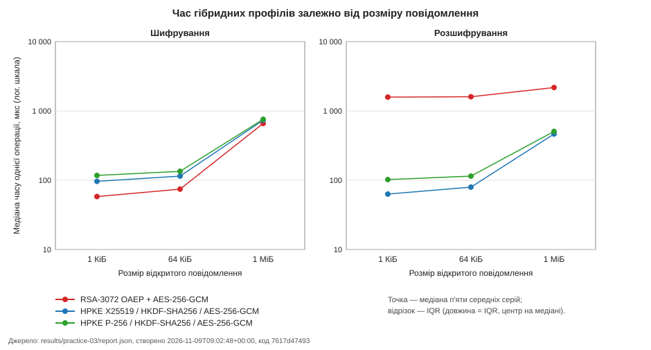
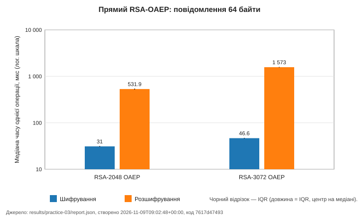
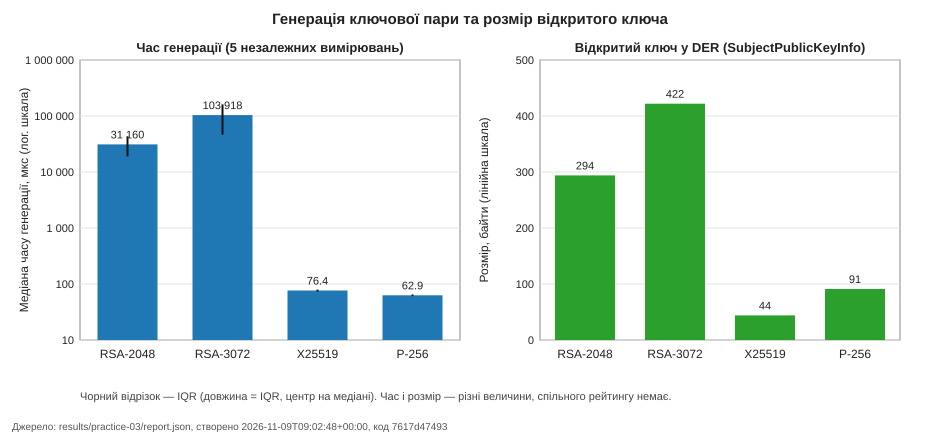

# Звіт практичної роботи 3: асиметричне та гібридне шифрування

## Титульні відомості

- Студент: Саверський Денис Миколайович, група 233 (online), номер у списку 17.
- Індивідуальний варіант: 17 mod 4 = **1** («Необов'язковий `payload_bytes`»).
- Дата: 09.11.2026.
- Форк: https://github.com/saverskiyden-sudo/digital-dean-api-starter.git; гілка `practice-03`; теги `practice-03-base` і `practice-03`.
- SHA останньої фіксації коду й тестів: `7617d474930080e04d46878c6ee23f7139f9d0a3`; SHA коду під час експерименту: `7617d474930080e04d46878c6ee23f7139f9d0a3`. Тег `practice-03` позначає фінальний коміт, який додає результати експерименту й цей звіт.

## Мета та продовження API

Це продовження того самого API «Цифровий деканат» (маршрути практичних 1 і 2 збережено). Гілка `practice-03` створена від тега `practice-02`, до неї злито `upstream/practice-03-starter` (базовий стан позначає тег `practice-03-base`).

- Тести перед імпортом (практична 2): `235 passed, 1 warning in 5.04s`.
- Тести практичних 1 і 2 одразу після імпорту стартера: `235 passed, 1 warning in 6.04s`.
- Повний набір після реалізації: `383 passed, 1 warning in 16.08s`.

Змінені модулі: `app/security/asymmetric` (профілі, адаптери), `app/schemas/asymmetric_report.py` (семантична перевірка й фільтр), `app/api/asymmetric_lab.py` (новий маршрут), `app/main.py` (підключення, версія 0.3.0), `benchmarks/asymmetric_benchmark.py`, `benchmarks/make_asymmetric_charts.py`, `benchmarks/make_asymmetric_report.py`, тести, колекція Postman. Новий маршрут `GET /api/v1/lab/crypto/asymmetric-benchmark-results` лише читає збережений звіт і перевіряє його; експеримент із HTTP не запускається.

## Середовище та методика

| Параметр | Значення |
|---|---|
| Python | 3.13.16 |
| cryptography | 48.0.1 |
| OpenSSL бібліотеки | OpenSSL 4.0.1 9 Jun 2026 |
| ОС | Windows-10-10.0.19045-SP0 |
| CPU | AMD Ryzen 5 5500 |
| Час створення звіту (UTC) | 2026-11-09T09:02:48+00:00 |
| Код під час запуску | `7617d474930080e04d46878c6ee23f7139f9d0a3` |

Усі вимірювання виконано на одному комп'ютері в одному процесі; профіль часу: 10 прогрівальних операцій, 5 серій по 20 операцій, 5 незалежних вимірювань генерації кожного типу ключа. Ключі одержувача створюються поза таймером. Перед кожною серією порядок 22 комбінацій циклічно зсувається на одну позицію (базовий порядок: профілі за таблицею 1, для кожного операція encrypt, потім decrypt, розміри за зростанням). Усередині таймера: для шифрування — виклик `encrypt` (у гібриді це свіжий ключ AES, nonce, OAEP-шифрування ключа й AES-GCM; у HPKE увесь `Suite.encrypt`); для розшифрування — тільки 20 викликів `decrypt` над заздалегідь підготовленими коректними конвертами. Перевірка відновлених даних, серіалізація DER, запис файлів і JSON — поза таймером. Годинник `time.perf_counter_ns`.

Статистика: час однієї операції в серії `t_r = Δt_r / N`, N = 20; `median_ns` — медіана п'яти `t_r`; IQR = Q3−Q1 методом `statistics.quantiles(..., method="inclusive")`; пропускна здатність гібридних профілів `v = S · 10^9 / (2^20 · t_m)` МіБ/с, для прямих RSA не обчислюється.

## Коректність і параметри

Профілі: `rsa2048-oaep`, `rsa3072-oaep` (SHA-256 в OAEP і MGF1, e = 65537, 64 байти), навчальний `rsa3072-oaep-aes256gcm` та два профілі HPKE Base (`DHKEM(X25519, HKDF-SHA256)` і `DHKEM(P-256, HKDF-SHA256)`, HKDF-SHA256, AES-256-GCM) для 1024, 65536 і 1048576 байтів. Використано тільки бібліотечні операції: власних примітивів, raw RSA, PKCS#1 v1.5 чи власного KDF немає.

Межа OAEP: `m_max = k − 2·hLen − 2` дає 190 байтів для RSA-2048 і 318 байтів для RSA-3072; перевірка `oaep_boundary` підтверджує успіх на `m_max` і відмову на `m_max + 1`.

Ключові фрагменти адаптера (навчальний гібрид; свіжі ключ AES і nonce для кожного повідомлення):

```python
key = AESGCM.generate_key(bit_length=256)
nonce = secrets.token_bytes(12)
wrapped = public.encrypt(key, _oaep(context))
return wrapped + nonce + AESGCM(key).encrypt(nonce, message, context)
```

Конверт: `wrapped_key[384] || nonce[12] || ciphertext_with_tag`. Для HPKE: `Suite(KEM.X25519 або KEM.P256, KDF.HKDF_SHA256, AEAD.AES_256_GCM).encrypt(message, public, info=context)`; результат `enc || ct` не перекодується. Розшифрування будь-якої відмови (невірний тег, ключ, контекст, довжина) повертає єдину помилку `DecryptionError` без часткового відкритого тексту.

Контекст `b"digital-dean:practice-03:report-v1"` передається по-різному: OAEP `label` (прямий RSA), OAEP `label` і AAD AES-GCM (гібрид), HPKE `info`. Це різні механізми, хоч значення збігаються. HPKE Base не автентифікує відправника: кожен, хто знає відкритий ключ, може створити повідомлення; те саме стосується RSA-профілів.

Перевірок коректності 22: `roundtrip`, `wrong_key`, `tamper`, `wrong_context` для п'яти профілів і `oaep_boundary` для двох прямих RSA. Пройдено 22, невдалих 0.

## Результати

Файли: `results/practice-03/raw.csv` (130 рядків без заголовка: 20 генерацій ключа + 110 серій), `results/practice-03/report.json` (4 генерації, 22 результати, 22 перевірки), `results/practice-03/summary.md`.

Звіт створено 2026-11-09T09:02:48+00:00, код `7617d474930080e04d46878c6ee23f7139f9d0a3`.
Час — мкс на одну операцію (медіана п'яти середніх серій по 20 операцій), IQR — Q3−Q1 (inclusive).
Швидкість — МіБ/с за байтами початкового повідомлення; для прямих RSA не обчислюється.

#### Генерація ключової пари

| Ключ | Медіана, мкс | IQR, мкс | Відкритий ключ DER, байтів |
|---|---|---|---|
| RSA-2048 | 31159.50 | 24360.40 | 294 |
| RSA-3072 | 103918.40 | 114950.50 | 422 |
| X25519 | 76.40 | 5.90 | 44 |
| P-256 | 62.90 | 4.30 | 91 |

#### Шифрування й розшифрування

| Профіль | Операція | Розмір | Медіана, мкс | IQR, мкс | МіБ/с | Двійковий результат, байтів |
|---|---|---|---|---|---|---|
| RSA-2048 OAEP | decrypt | 64 Б | 531.89 | 18.45 | — | 256 |
| RSA-2048 OAEP | encrypt | 64 Б | 31.04 | 0.94 | — | 256 |
| RSA-3072 OAEP | decrypt | 64 Б | 1572.82 | 32.86 | — | 384 |
| RSA-3072 OAEP | encrypt | 64 Б | 46.58 | 0.99 | — | 384 |
| RSA-3072 OAEP + AES-256-GCM | decrypt | 1 КіБ | 1580.59 | 8.86 | 0.6 | 1436 |
| RSA-3072 OAEP + AES-256-GCM | decrypt | 64 КіБ | 1600.86 | 5.17 | 39.0 | 65948 |
| RSA-3072 OAEP + AES-256-GCM | decrypt | 1 МіБ | 2172.48 | 19.83 | 460.3 | 1048988 |
| RSA-3072 OAEP + AES-256-GCM | encrypt | 1 КіБ | 58.02 | 2.15 | 16.8 | 1436 |
| RSA-3072 OAEP + AES-256-GCM | encrypt | 64 КіБ | 74.36 | 2.67 | 840.5 | 65948 |
| RSA-3072 OAEP + AES-256-GCM | encrypt | 1 МіБ | 659.65 | 6.79 | 1516.0 | 1048988 |
| HPKE X25519 / HKDF-SHA256 / AES-256-GCM | decrypt | 1 КіБ | 63.06 | 0.34 | 15.5 | 1072 |
| HPKE X25519 / HKDF-SHA256 / AES-256-GCM | decrypt | 64 КіБ | 79.39 | 0.63 | 787.3 | 65584 |
| HPKE X25519 / HKDF-SHA256 / AES-256-GCM | decrypt | 1 МіБ | 464.10 | 19.50 | 2154.7 | 1048624 |
| HPKE X25519 / HKDF-SHA256 / AES-256-GCM | encrypt | 1 КіБ | 96.28 | 1.61 | 10.1 | 1072 |
| HPKE X25519 / HKDF-SHA256 / AES-256-GCM | encrypt | 64 КіБ | 114.58 | 5.66 | 545.5 | 65584 |
| HPKE X25519 / HKDF-SHA256 / AES-256-GCM | encrypt | 1 МіБ | 734.57 | 18.36 | 1361.3 | 1048624 |
| HPKE P-256 / HKDF-SHA256 / AES-256-GCM | decrypt | 1 КіБ | 102.03 | 0.52 | 9.6 | 1105 |
| HPKE P-256 / HKDF-SHA256 / AES-256-GCM | decrypt | 64 КіБ | 114.67 | 2.42 | 545.1 | 65617 |
| HPKE P-256 / HKDF-SHA256 / AES-256-GCM | decrypt | 1 МіБ | 506.13 | 0.79 | 1975.8 | 1048657 |
| HPKE P-256 / HKDF-SHA256 / AES-256-GCM | encrypt | 1 КіБ | 117.30 | 2.10 | 8.3 | 1105 |
| HPKE P-256 / HKDF-SHA256 / AES-256-GCM | encrypt | 64 КіБ | 134.34 | 0.39 | 465.3 | 65617 |
| HPKE P-256 / HKDF-SHA256 / AES-256-GCM | encrypt | 1 МіБ | 756.99 | 12.29 | 1321.0 | 1048657 |

#### Перевірки коректності

Усього 22, пройдено 22, невдалих 0.

Графіки (джерело чисел — `report.json`; одиниці: мкс; відрізок — IQR):







Спостереження (обчислено з даних; порівнюються лише однакові розміри й операції):

- Генерація RSA-2048 тривала 31159.5 мкс, RSA-3072 — 103918.4 мкс, X25519 — 76.4 мкс, P-256 — 62.9 мкс (медіани п'яти незалежних вимірювань). RSA-3072 генерується приблизно у 3.3 раза довше за RSA-2048; найшвидша з чотирьох операцій — P-256.
- RSA-2048 OAEP, 64 байти: шифрування 31.0 мкс, розшифрування 531.9 мкс; розшифрування триває довше у 17.1 раза.
- RSA-3072 OAEP, 64 байти: шифрування 46.6 мкс, розшифрування 1572.8 мкс; розшифрування триває довше у 33.8 раза.
- encrypt, 1 КіБ: найменша медіана у профілю RSA-3072 OAEP + AES-256-GCM (58.0 мкс); наступний профіль повільніший приблизно у 1.66 раза.
- encrypt, 64 КіБ: найменша медіана у профілю RSA-3072 OAEP + AES-256-GCM (74.4 мкс); наступний профіль повільніший приблизно у 1.54 раза.
- encrypt, 1 МіБ: найменша медіана у профілю RSA-3072 OAEP + AES-256-GCM (659.6 мкс); наступний профіль повільніший приблизно у 1.11 раза.
- decrypt, 1 КіБ: найменша медіана у профілю HPKE X25519 / HKDF-SHA256 / AES-256-GCM (63.1 мкс); наступний профіль повільніший приблизно у 1.62 раза.
- decrypt, 64 КіБ: найменша медіана у профілю HPKE X25519 / HKDF-SHA256 / AES-256-GCM (79.4 мкс); наступний профіль повільніший приблизно у 1.44 раза.
- decrypt, 1 МіБ: найменша медіана у профілю HPKE X25519 / HKDF-SHA256 / AES-256-GCM (464.1 мкс); наступний профіль повільніший приблизно у 1.09 раза.

Накладні витрати двійкового конверта сталі й не залежать від швидкості: RSA-3072 + AES-GCM — S + 412 байтів, HPKE X25519 — S + 48, HPKE P-256 — S + 81; прямі RSA дають 256 і 384 байти. Розмір відкритого ключа в DER: RSA-2048 — 294 байти, RSA-3072 — 422, X25519 — 44, P-256 — 91.

## API та індивідуальний варіант

Контракт: `200` повний валідний звіт (4 `key_generation`, 22 `results`, 22 `checks`); `404` `{"detail": "benchmark report not found"}`; `500` `{"detail": "benchmark report invalid"}` без шляху й стека; `422` для непідтримуваного `payload_bytes`. Модель відповіді `BenchmarkResponse`; повний файл спочатку проходить `validate_complete_report`, потім фільтруються лише `results`.

Варіант 1: необов'язковий параметр `payload_bytes` (тип `int`, явна перевірка переліку 64, 1024, 65536, 1048576). Для 64 повертається 4 результати, для кожного з інших значень по 6; `key_generation` і `checks` лишаються повними; інші значення дають `422`. Приклад відповіді `?payload_bytes=1024` (початок, із власного звіту):

```json
{
  "schema_version": 1,
  "key_generation": [
    "... (4)"
  ],
  "results": [
    {
      "profile": "rsa3072-oaep-aes256gcm",
      "group": "hybrid",
      "operation": "encrypt",
      "payload_bytes": 1024,
      "series": 5,
      "operations_per_series": 20,
      "median_ns": 58025.0,
      "iqr_ns": 2145.0,
      "ciphertext_bytes": 1436,
      "throughput_mib_s": 16.830030159414047
    },
    "... (ще 5)"
  ],
  "checks": [
    "... (22)"
  ]
}
```

HTTP-маршрут не імпортує й не викликає експеримент, не приймає шлях файлу чи алгоритм від клієнта (шлях `REPORT_PATH` задає лише сервер) і не повертає ключів, відкритих текстів, конвертів чи локальних шляхів.

## Перевірки

- `pytest`: `383 passed, 1 warning in 16.08s`; власні тести: схема й семантика звіту (дублікати, покриття, довжини, формула пропускної здатності, NaN/Inf, типи, UTC, SHA), адаптери (довжини, підміна кожної області байтів, контекст, неправильні типи ключів, свіжість матеріалу), експеримент (параметри, зсув порядку, запис файлів, відсутність секретів), API (200/404/500/422, варіант, `false` у перевірках, відсутність запуску експерименту), регресії практичних 1 і 2.
- Postman: колекція `postman/digital-dean-practice-03.postman_collection.json`, змінна `variant` = 1; запити 01, 02, 03B, 04B виконуються, інші варіанти пропускаються; кроки 404/500 виконуються вручну на тимчасових файлах.
- Негативні результати не приховуються: `passed=false` зберігається у звіті й повертається API.

## Git

Віддалений репозиторій: `https://github.com/saverskiyden-sudo/digital-dean-api-starter.git`. Власні коміти після `practice-03-base`:

```text
c64ece7 Implement RSA-OAEP, hybrid and HPKE encryption adapters
7fe7d79 Add asymmetric experiment, report validation and charts
dde903b Add asymmetric benchmark route with payload_bytes variant and bump to 0.3.0
7617d47 Add practice 3 tests and Postman variant scenarios
(цей коміт) Add practice 3 results, charts, README and report
```

Коміти імпорту та викладача не враховано. `practice-02` є предком `HEAD`; теги `practice-03-base` і `practice-03` опубліковано.

## Висновки та межі

- Швидкість, накладні витрати й коректність розглядаються окремо. Час у цьому експерименті є властивістю конкретної реалізації, версій бібліотеки та OpenSSL, процесора й навантаження; інший комп'ютер дасть інші числа.
- Прямий RSA-OAEP придатний лише для коротких даних (до 190 і 318 байтів); для довших повідомлень використовують гібридну схему, у якій асиметрична операція захищає лише ключ.
- HPKE Base — стандартизована композиція KEM, KDF й AEAD, яку реалізує бібліотечний `Suite`; навчальний RSA/AES-гібрид не є HPKE і має власний фіксований формат конверта.
- Ніякий профіль не названо «найкращим» чи криптографічно сильнішим лише за часом або довжиною ключа: довжини ключів RSA, AES і кривих мають різний зміст.
- Обмеження: один запуск на одному комп'ютері; HPKE Base і RSA не автентифікують відправника; відмова після пошкодження не замінює підпису чи автентифікації користувача; цифрові підписи, постквантові алгоритми, побічні канали й сертифікація реалізації не досліджувались; сервер навчальний, локальний, без автентифікації, TLS і керування ключами, тому його не можна відкривати назовні.

## Використані джерела

Перелік складено за списком джерел із завдання практичної роботи (дата звернення в завданні: 7 жовтня 2026 року).

[1] RFC 8017 PKCS 1 v2.2, розділ 7.1 RSAES-OAEP. https://www.rfc-editor.org/rfc/rfc8017.html
[2] RFC 9180 Hybrid Public Key Encryption, розділи 4, 5, 7, 9. https://www.rfc-editor.org/rfc/rfc9180.html
[3] RFC 7748 Elliptic Curves for Security. https://www.rfc-editor.org/rfc/rfc7748.html
[4] RFC 5869 HKDF. https://www.rfc-editor.org/rfc/rfc5869.html
[5] cryptography 48, RSA. https://cryptography.io/en/48.0.0/hazmat/primitives/asymmetric/rsa/
[6] cryptography 48, Hybrid Public Key Encryption. https://cryptography.io/en/48.0.0/hazmat/primitives/hpke/
[7] cryptography 48, Authenticated encryption. https://cryptography.io/en/48.0.0/hazmat/primitives/aead/
[8] cryptography 48, Elliptic curve cryptography. https://cryptography.io/en/48.0.0/hazmat/primitives/asymmetric/ec/
[9] cryptography 48, X25519. https://cryptography.io/en/48.0.0/hazmat/primitives/asymmetric/x25519/
[10] Python 3.12, time.perf_counter_ns. https://docs.python.org/3.12/library/time.html#time.perf_counter_ns
[11] Python 3.12, statistics. https://docs.python.org/3.12/library/statistics.html
[12] Python 3.12, json. https://docs.python.org/3.12/library/json.html
[13] Pydantic, Models. https://docs.pydantic.dev/latest/concepts/models/
[14] FastAPI, Response Model. https://fastapi.tiangolo.com/tutorial/response-model/
[15] FastAPI, Handling Errors. https://fastapi.tiangolo.com/tutorial/handling-errors/
[16] FastAPI, Testing. https://fastapi.tiangolo.com/tutorial/testing/
[17] Postman, test scripts. https://learning.postman.com/docs/tests-and-scripts/write-scripts/test-scripts/
[18] Git, merge. https://git-scm.com/docs/git-merge
[19] Git, tag. https://git-scm.com/docs/git-tag
[20] GitHub, Fork a repository. https://docs.github.com/en/pull-requests/collaborating-with-pull-requests/working-with-forks/fork-a-repo
[21] cryptography 48, Serialization. https://cryptography.io/en/48.0.0/hazmat/primitives/asymmetric/serialization/
[22] Python 3.12, secrets. https://docs.python.org/3.12/library/secrets.html

## Алфавітний глосарій

- **AAD.** Additional Authenticated Data; додаткові автентифіковані дані: перевіряються на цілісність разом із шифротекстом, але не шифруються.
- **AEAD.** Authenticated Encryption with Associated Data; автентифіковане шифрування з асоційованими даними.
- **AES.** Advanced Encryption Standard; розширений стандарт шифрування, симетричний блоковий шифр.
- **API.** Application Programming Interface; прикладний програмний інтерфейс, тут HTTP-маршрути FastAPI.
- **Base mode.** Базовий режим HPKE без автентифікації відправника.
- **CSV.** Comma Separated Values; текстовий табличний формат значень, розділених комами.
- **DER.** Distinguished Encoding Rules; канонічне двійкове кодування ASN.1.
- **DHKEM.** Diffie–Hellman Key Encapsulation Mechanism; інкапсуляція ключа на основі Діффі–Геллмана.
- **enc.** Дані інкапсуляції ключа в HPKE: серіалізований ефемерний відкритий ключ.
- **GCM.** Galois/Counter Mode; режим автентифікованого шифрування, додає 16-байтовий тег.
- **HKDF.** HMAC-based Extract-and-Expand Key Derivation Function; функція виведення ключів на основі HMAC.
- **HPKE.** Hybrid Public Key Encryption; гібридне шифрування з відкритим ключем (RFC 9180): KEM + KDF + AEAD.
- **info.** Контекстний параметр HPKE, що входить до побудови ключового контексту.
- **IQR.** Interquartile Range; міжквартильний розмах Q3−Q1, міра розкиду п'яти значень.
- **KDF.** Key Derivation Function; функція виведення ключів.
- **KEM.** Key Encapsulation Mechanism; механізм інкапсуляції ключа.
- **label.** Мітка OAEP: контекстні байти, які мають збігатися при шифруванні та розшифруванні.
- **MGF1.** Mask Generation Function 1; функція генерації маски в OAEP.
- **MiB/s.** Мебібайти за секунду (2^20 байтів), а не десяткові мегабайти.
- **nonce.** Number used once; одноразове значення, у AES-GCM 12 байтів, яке не повторюється з тим самим ключем.
- **OAEP.** Optimal Asymmetric Encryption Padding; випадкове доповнення для RSA-шифрування.
- **P-256.** Еліптична крива secp256r1; у роботі застосовується всередині DHKEM HPKE.
- **RSA.** Rivest–Shamir–Adleman; асиметричний алгоритм; тут RSAES-OAEP для коротких даних або ключа AES.
- **SHA-256.** Secure Hash Algorithm; хеш-функція з 256-бітовим результатом.
- **SPKI.** SubjectPublicKeyInfo; структура відкритого ключа, довжину якої вимірювали у DER.
- **Suite.** Об'єкт набору алгоритмів HPKE в cryptography (KEM, KDF, AEAD).
- **UTC.** Coordinated Universal Time; всесвітній координований час.
- **X25519.** Функція узгодження ключів на Curve25519 (RFC 7748); у роботі використовується всередині HPKE.
- **Асиметричне шифрування.** Шифрування відкритим ключем одержувача й розшифрування його приватним ключем; не тотожне цифровому підпису.
- **Гібридне шифрування.** Асиметричний захист ключового матеріалу разом із симетричним шифруванням самого повідомлення.
- **Двійковий конверт.** Послідовність байтів результату шифрування; довжину вимірюють без JSON чи Base64.
- **Медіана.** Центральне значення впорядкованої вибірки; тут медіана п'яти середніх часів серій.
- **Прогрів.** Попередні операції для стабілізації середовища; не входять у сирі вимірювання.
- **Синтетичні дані.** Штучні повідомлення без реальних персональних даних.
- **Тег автентифікації.** 16 байтів AEAD для виявлення неправильного ключа чи змін у даних.
- **Шифротекст.** Результат шифрування відкритого тексту.
