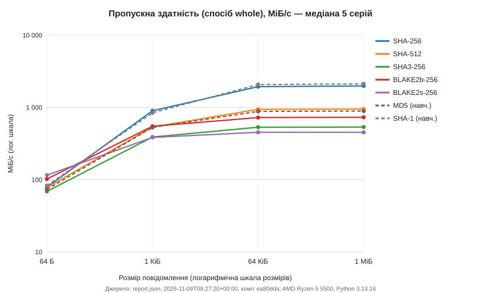
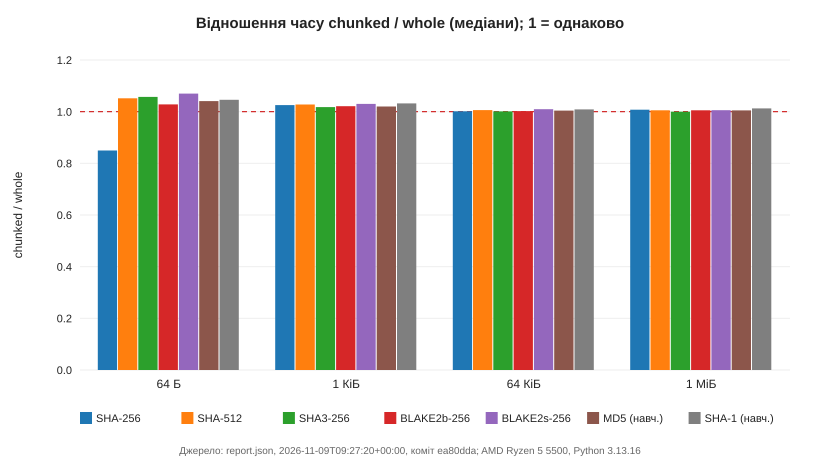
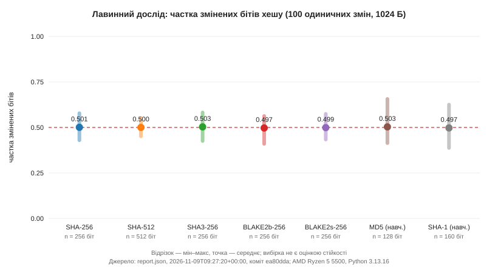

# Звіт із практичної роботи 4: дослідження алгоритмів хешування

## Відомості

- Студент: Саверський Денис Миколайович, група 233 (online), номер у списку 17.
- Індивідуальний варіант: 17 mod 4 = **1** — параметр `payload_bytes`.
- Дата експерименту (UTC): 2026-11-09T09:27:20+00:00.
- Форк: https://github.com/saverskiyden-sudo/digital-dean-api-starter; гілка `practice-04`; теги `practice-04-base` і `practice-04`.
- `source_commit`: `ea80dda382981529a06654086629210d0f3dd5b1` (зафіксований код до запуску; предок тегу `practice-04`).

## Мета і реалізовані зміни

Мета — дослідити швидкодію, коректність і лавинний ефект семи профілів хешування та повернути перевірений звіт новим методом того самого API «Цифровий деканат». Гілка `practice-04` продовжує тег `practice-03`; до неї злито `upstream/practice-04-starter` (baseline — тег `practice-04-base`). Маршрути практичних 1–3 збережено, версію API оновлено до 0.4.0.

| Модуль | Зміна |
|---|---|
| `app/security/hashing/adapters.py` | `prepare_operation` (перевірка входу й нарізання блоків поза таймером, новий стан на кожен виклик), `hash_bytes` (whole/chunked), `hamming_bits` |
| `app/schemas/hash_report.py` | `validate_report`: покриття матриці, унікальність, статуси недоступності, UTC-дата, довжини, повтори, формула пропускної здатності, межі лавинного досліду, перевірки; `filter_by_payload` для варіанта |
| `app/api/hash_lab.py` | новий `GET /api/v1/lab/crypto/hash-benchmark-results` з `response_model=HashResponse` і параметром `payload_bytes` |
| `app/main.py`, `pyproject.toml` | підключення маршрутизатора до наявного застосунку, версія 0.4.0 |
| `benchmarks/hash_benchmark.py` | експеримент: прогрів, 5 серій, raw.csv, 6 перевірок, лавинний дослід, avalanche.csv, report.json |
| `benchmarks/make_hash_charts.py`, `make_hash_report.py` | графіки й цей звіт з власних даних |
| `tests/test_hash_variant.py`, Postman | власні тести варіанта, звіту, сирих даних, HTTP і регресій; змінна `variant`=1 |

**Індивідуальний варіант 1.** Необов'язковий параметр запиту `payload_bytes` (тип `int`) з явною перевіркою переліку 64, 1024, 65536, 1048576. Без параметра повертаються всі 56 результатів; з параметром — по 14 (усі доступні профілі × whole/chunked). Значення 65, 0, від'ємні, 1048577 та нечислові дають 422. Спочатку весь файл перевіряється як `HashReport`, потім фільтрується лише `results`; `algorithms`, `avalanche` і `checks` лишаються повними.

```python
if payload_bytes is not None and payload_bytes not in PAYLOAD_SIZES:
    raise HTTPException(422, "unsupported payload_bytes")
return filter_by_payload(load_report(), payload_bytes)
```

## Середовище і методика

| Параметр | Значення |
|---|---|
| Python | 3.13.16 |
| ОС | Windows-10-10.0.19045-SP0 |
| Процесор | AMD Ryzen 5 5500 |
| Архітектура | AMD64 |
| OpenSSL модуля ssl | OpenSSL 3.5.9 29 Sep 2026 |

| Профіль | Конструктор | Довжина, байтів | Доступність | Реалізація |
|---|---|---|---|---|
| sha256 | `sha256()` | 32 | доступний | `_hashlib.HASH` |
| sha512 | `sha512()` | 64 | доступний | `_hashlib.HASH` |
| sha3-256 | `sha3_256()` | 32 | доступний | `_hashlib.HASH` |
| blake2b-256 | `blake2b(digest_size=32)` | 32 | доступний | `_blake2.blake2b` |
| blake2s-256 | `blake2s(digest_size=32)` | 32 | доступний | `_blake2.blake2s` |
| md5 | `md5(usedforsecurity=False)` | 16 | доступний | `_hashlib.HASH` |
| sha1 | `sha1(usedforsecurity=False)` | 20 | доступний | `_hashlib.HASH` |

Розміри: 64, 1024, 65536, 1048576 байтів; способи whole та chunked (блоки 16384 байтів); прогрів 10 операцій на поєднання; 5 серій по 1000 повторів (по 100 для 1 МіБ). Серії чергуються між усіма поєднаннями, щоб розподілити вплив фонового навантаження. У таймер входять створення нового об'єкта, `update`, `digest` і цикл повторів; генерація синтетичних байтів, нарізання блоків, прогрів, перевірки, hex, JSON і файли — поза таймером. Годинник `time.perf_counter_ns`. Медіана й IQR — для п'яти середніх часів серій (`statistics.quantiles(..., method="inclusive")`), пропускна здатність v = S·10⁹ / (2²⁰·t_m) МіБ/с. Вимір містить накладні витрати Python, тому для малих повідомлень він показує передусім вартість виклику, а не криптопримітиву.

Лавинний дослід: ті самі 1024 синтетичні байти для всіх профілів; у досліді i (i = 0..99) у новій копії оригіналу змінюється біт i (байт i//8, маска 1<<(i%8)); відстань Геммінга рахується між бітами хешів, частка a = d/n.

## Результати

Файли: `results/practice-04/raw.csv` (280 рядків без заголовка), `results/practice-04/avalanche.csv` (700 рядків), `results/practice-04/report.json` (56 агрегатів, 7 лавинних агрегатів, 42 перевірок). Узгодженість raw.csv з медіанами report.json і арифметику elapsed_ns/repeats перевірено під час створення цього звіту.

#### Медіана часу однієї операції, мкс (IQR), спосіб whole

| Профіль | 64 Б | 1 КіБ | 64 КіБ | 1 МіБ |
|---|---|---|---|---|
| SHA-256 | 0.77 (0.07) | 1.09 (0.06) | 32.23 (0.10) | 503.58 (1.42) |
| SHA-512 | 0.79 (0.00) | 1.82 (0.00) | 66.48 (0.02) | 1053.14 (3.15) |
| SHA3-256 | 0.89 (0.00) | 2.51 (0.01) | 117.32 (0.31) | 1868.99 (1.36) |
| BLAKE2b-256 | 0.60 (0.01) | 1.78 (0.01) | 86.31 (0.09) | 1370.74 (3.86) |
| BLAKE2s-256 | 0.53 (0.01) | 2.54 (0.01) | 137.76 (2.20) | 2208.91 (16.72) |
| MD5 (навч.) | 0.83 (0.00) | 1.85 (0.02) | 70.92 (0.31) | 1122.37 (3.05) |
| SHA-1 (навч.) | 0.74 (0.00) | 1.16 (0.00) | 30.16 (0.06) | 471.01 (1.06) |

#### Пропускна здатність, МіБ/с (whole / chunked)

| Профіль | 64 Б | 1 КіБ | 64 КіБ | 1 МіБ |
|---|---|---|---|---|
| SHA-256 | 78.9 / 92.9 | 899.7 / 877.3 | 1939.3 / 1936.5 | 1985.8 / 1970.8 |
| SHA-512 | 77.7 / 73.9 | 536.5 / 522.1 | 940.1 / 934.3 | 949.5 / 944.4 |
| SHA3-256 | 68.9 / 65.2 | 389.7 / 382.9 | 532.7 / 532.2 | 535.0 / 535.1 |
| BLAKE2b-256 | 102.3 / 99.5 | 549.5 / 538.1 | 724.1 / 722.5 | 729.5 / 725.8 |
| BLAKE2s-256 | 115.7 / 108.1 | 384.9 / 373.6 | 453.7 / 449.5 | 452.7 / 450.2 |
| MD5 (навч.) | 73.5 / 70.6 | 528.8 / 518.5 | 881.3 / 877.6 | 891.0 / 886.7 |
| SHA-1 (навч.) | 82.7 / 79.1 | 842.2 / 816.0 | 2072.1 / 2053.8 | 2123.1 / 2096.4 |

#### Лавинний дослід (1024 байти, 100 одиничних змін)

| Профіль | Біт хешу | Мін | Макс | Середнє | Середня частка |
|---|---|---|---|---|---|
| SHA-256 | 256 | 110 | 148 | 128.20 | 0.5008 |
| SHA-512 | 512 | 231 | 282 | 256.03 | 0.5001 |
| SHA3-256 | 256 | 109 | 149 | 128.75 | 0.5029 |
| BLAKE2b-256 | 256 | 105 | 144 | 127.19 | 0.4968 |
| BLAKE2s-256 | 256 | 111 | 147 | 127.74 | 0.4990 |
| MD5 (навч.) | 128 | 53 | 84 | 64.39 | 0.5030 |
| SHA-1 (навч.) | 160 | 62 | 100 | 79.60 | 0.4975 |

Графіки (джерело — report.json):







Спостереження (обчислено з даних цього запуску):

- 64 Б, whole: найменша медіана у BLAKE2s-256 (0.53 мкс), найбільша у SHA3-256 (0.89 мкс), різниця ≈ 1.68 раза.
- 1 МіБ, whole: найменша медіана у SHA-1 (навч.) (471.01 мкс), найбільша у BLAKE2s-256 (2208.91 мкс), різниця ≈ 4.69 раза.
- Відношення chunked/whole лежить у межах 0.85–1.07: поблокова обробка дає той самий хеш (перевірка stream-equivalence), а різниця в часі — це накладні витрати додаткових викликів `update` і шум вимірювання.
- Пропускна здатність на 64 байтах (69–116 МіБ/с) значно нижча, ніж на 1 МіБ (453–2123 МіБ/с): для коротких повідомлень домінує стала вартість створення об'єкта й викликів Python.
- Середня частка змінених бітів для всіх профілів 0.497–0.503, тобто близько половини, зокрема й для MD5/SHA-1. Це спостереження не є доказом стійкості до колізій.

Ранжування стосується лише цього комп'ютера, цих версій Python/OpenSSL і розмірів; на іншій машині порядок може змінитися.

## API та перевірки

Контракт `GET /api/v1/lab/crypto/hash-benchmark-results`: `200` — перевірений `HashResponse` (діагностичні `passed=false` не приховуються); `404` — `{"detail": "hash report not found"}`; `500` — `{"detail": "hash report invalid"}` без шляхів і трасування; `422` — неприйнятний `payload_bytes`. Читання обмежене 1 МіБ + 1 байт, повторні ключі JSON, NaN та Infinity відхиляються. Маршрут не запускає вимірювань, не приймає шляхів, документів чи паролів.

Приклад відповіді `?payload_bytes=1024` (початок, з власного звіту):

```json
{
  "schema_version": 1,
  "created_at": "2026-11-09T09:27:20+00:00",
  "source_commit": "ea80dda382981529a06654086629210d0f3dd5b1",
  "algorithms": [
    "... (7)"
  ],
  "results": [
    {
      "algorithm": "sha256",
      "mode": "whole",
      "payload_bytes": 1024,
      "digest_bytes": 32,
      "repeats": 1000,
      "median_ns": 1085.4,
      "iqr_ns": 57.5,
      "throughput_mib_s": 899.7259074995393
    },
    "... (ще 13)"
  ],
  "avalanche": [
    "... (7)"
  ],
  "checks": [
    "... (42)"
  ],
  "summary": null
}
```

- `pytest`: `537 passed, 0 failed, 0 skipped in 18.27s`.
- Власні тести (`tests/test_hash_variant.py`): варіант (усі чотири розміри, 65/0/від'ємні/1048577/нечислові → 422, повна перевірка до фільтра, збереження `passed=false`), дата UTC (+00:00/Z, інший пояс, неіснуюча дата, майбутнє), пропущені й зайві записи, непослідовні статуси недоступності, NaN/Infinity/рядкові числа/bool, точні bytes, BLAKE2 не є обрізаним BLAKE2b-512, арифметика raw.csv і avalanche.csv, відсутність локальних шляхів у JSON, відмова експерименту на незафіксованому коді, відсутність імпорту `benchmarks` у маршруті, регресії практичних 1–3.
- Postman: `postman/digital-dean-practice-04.postman_collection.json`, `variant` = 1; виконуються 01, 02, 03B, 04B, до 03B додано власну перевірку повноти `algorithms/avalanche/checks`; ручні стани `missing`/`invalid` — окремо.
- Перевірки коректності: 42, невдалих 0.

## Історія Git

Гілка `practice-04` створена від тега `practice-03` (`git merge-base --is-ancestor practice-03 HEAD` успішна), baseline — `practice-04-base`. Власні коміти після baseline:

```text
672b6e7 Implement whole and chunked hashing adapters and Hamming distance
ace7220 Add hash experiment and complete report validation
fdf8ff3 Add hash results route with payload_bytes variant and bump to 0.4.0
ea80dda Add practice 4 tests, Postman variant, charts and report tools
```

`source_commit` зі звіту є предком фінального тегу `practice-04`; результати додано окремим комітом.

## Висновки та межі

- Швидкість, правильність і криптографічні властивості розглянуто окремо. Числа часу — властивість цього комп'ютера, реалізацій hashlib/OpenSSL і накладних витрат Python, а не алгоритмів узагалі.
- Усі доступні профілі пройшли відомі вектори, Unicode, детермінованість, довжину й еквівалентність whole/chunked.
- Лавинний дослід охоплює лише 100 позицій одного повідомлення; частка близько 0,5 не доводить стійкості. MD5 і SHA-1 мають відомі практичні колізійні атаки (RFC 6151, NIST) і використані лише навчально.
- Хеш підтверджує збіг точних байтів з еталоном лише тоді, коли сам еталон отримано довіреним каналом; інакше порушник може замінити і файл, і контрольне значення.
- Швидкий хеш (навіть із сіллю) не є достатнім захистом паролів: для них потрібні спеціальні повільні схеми (OWASP).
- Обмеження: один запуск на одному комп'ютері; HMAC, підписи й паролі не досліджувались; API навчальний, локальний, без автентифікації.

## Використані джерела

Дата звернення: 23 жовтня 2026 року (за переліком завдання).

[1] Python 3.12, hashlib. https://docs.python.org/3.12/library/hashlib.html  
[2] NIST FIPS 180-4 Secure Hash Standard. https://csrc.nist.gov/pubs/fips/180-4/upd1/final  
[3] NIST FIPS 202 SHA-3 Standard. https://csrc.nist.gov/pubs/fips/202/final  
[4] RFC 7693 BLAKE2. https://www.rfc-editor.org/rfc/rfc7693.html  
[5] NIST Hash Functions. https://csrc.nist.gov/projects/hash-functions  
[6] RFC 6151 Updated Security Considerations for MD5. https://www.rfc-editor.org/rfc/rfc6151.html  
[7] Python 3.12, time.perf_counter_ns. https://docs.python.org/3.12/library/time.html#time.perf_counter_ns  
[8] Python 3.12, statistics. https://docs.python.org/3.12/library/statistics.html  
[9] Python 3.12, json. https://docs.python.org/3.12/library/json.html  
[10] FastAPI, Response Model. https://fastapi.tiangolo.com/tutorial/response-model/  
[11] FastAPI, Handling Errors. https://fastapi.tiangolo.com/tutorial/handling-errors/  
[12] FastAPI, Testing. https://fastapi.tiangolo.com/tutorial/testing/  
[13] Pydantic, Strict Mode. https://pydantic.dev/docs/validation/latest/concepts/strict_mode/  
[14] Git, merge. https://git-scm.com/docs/git-merge  
[15] Git, tag. https://git-scm.com/docs/git-tag  
[16] GitHub, Fork a repository. https://docs.github.com/en/pull-requests/how-tos/work-with-forks/fork-a-repo  
[17] Postman, Write scripts to test API response data. https://learning.postman.com/docs/tests-and-scripts/write-scripts/test-scripts/  
[18] OWASP Password Storage Cheat Sheet. https://cheatsheetseries.owasp.org/cheatsheets/Password_Storage_Cheat_Sheet.html  
[19] Python 3.12, ssl.OPENSSL_VERSION. https://docs.python.org/3.12/library/ssl.html#ssl.OPENSSL_VERSION  
[20] PyCryptodome, BLAKE2b. https://pycryptodome.readthedocs.io/en/latest/src/hash/blake2b.html  
[21] PyCryptodome, BLAKE2s. https://pycryptodome.readthedocs.io/en/latest/src/hash/blake2s.html  
[22] RFC 1321 The MD5 Message-Digest Algorithm (test suite). https://www.rfc-editor.org/rfc/rfc1321.html  
[23] RFC 6234 US Secure Hash Algorithms (reference code and tests). https://www.rfc-editor.org/rfc/rfc6234.html  

## Алфавітний глосарій

- **API.** Application Programming Interface; прикладний програмний інтерфейс — тут HTTP-маршрути того самого застосунку FastAPI.
- **BLAKE2b / BLAKE2s.** Сімейство хеш-функцій BLAKE2 (RFC 7693); у роботі з явно заданим digest_size=32, а не обрізанням довшого результату.
- **chunked.** Поблоковий спосіб: послідовні update блоками до 16384 байтів і один digest.
- **CSV.** Comma Separated Values; значення, розділені комами — формат сирих даних raw.csv та avalanche.csv.
- **digest.** Дайджест, контрольне значення — байти результату хешування для точного профілю й повідомлення.
- **FIPS.** Federal Information Processing Standards; федеральні стандарти обробки інформації США (FIPS 180-4, FIPS 202).
- **hashlib.** Стандартний модуль Python із конструкторами хеш-функцій.
- **HMAC.** Hash-based Message Authentication Code; код автентифікації повідомлення з секретним ключем — у роботу не входить.
- **IQR.** Interquartile Range; міжквартильний розмах Q3−Q1 п'яти середніх часів серій (метод inclusive).
- **JSON.** JavaScript Object Notation; текстовий формат звіту й відповіді API.
- **MD5.** Message Digest Algorithm 5; 128-бітовий застарілий профіль, лише для навчального порівняння.
- **MiB/s.** Мебібайти за секунду; 1 МіБ = 1048576 байтів.
- **NIST.** National Institute of Standards and Technology; Національний інститут стандартів і технологій США.
- **OpenSSL.** Криптографічна бібліотека; openssl_ssl у звіті — версія бібліотеки модуля ssl Python.
- **OWASP.** Open Worldwide Application Security Project; джерело настанов щодо зберігання паролів.
- **RFC.** Request for Comments; серія технічних публікацій Інтернету.
- **SHA.** Secure Hash Algorithm; алгоритм безпечного хешування — сімейства SHA-1, SHA-2, SHA-3.
- **source_commit.** SHA зафіксованого коду перед експериментом; предок фінального тегу practice-04.
- **UTC.** Coordinated Universal Time; всесвітній координований час — основа created_at.
- **UTF-8.** Unicode Transformation Format 8 bit; явне кодування тексту в байти перед хешуванням.
- **whole.** Цілісний спосіб: новий стан, один update усіма байтами та digest.
- **XOR.** Exclusive OR; виключне АБО — побітова операція для підрахунку відмінних бітів.
- **Відстань Геммінга.** Кількість відмінних бітів двох рівнодовгих хешів, а не відмінних символів hex.
- **Колізія.** Збіг хешів двох різних повідомлень; існування збігів не означає практичної легкості їх знаходження.
- **Лавинний ефект.** Значна зміна бітів результату після малої зміни входу; спостереження не доводить стійкості.
- **Медіана.** Центральне значення впорядкованої вибірки; тут третє з п'яти середніх часів серій.
- **Прогрів.** 10 повних операцій перед серіями; не входять у сирі вимірювання.
- **Прообраз.** Повідомлення, що дає заданий хеш; другий прообраз — інше повідомлення з хешем заданого.
- **Серія.** Окреме вимірювання 1000 (або 100 для 1 МіБ) повторів; середній час серії — одне спостереження.
- **Синтетичні дані.** Штучні публічні байти без реальних відомостей і персональних даних.
- **Стан хешування.** Об'єкт обробки одного повідомлення; для кожного повідомлення створюється новий.
